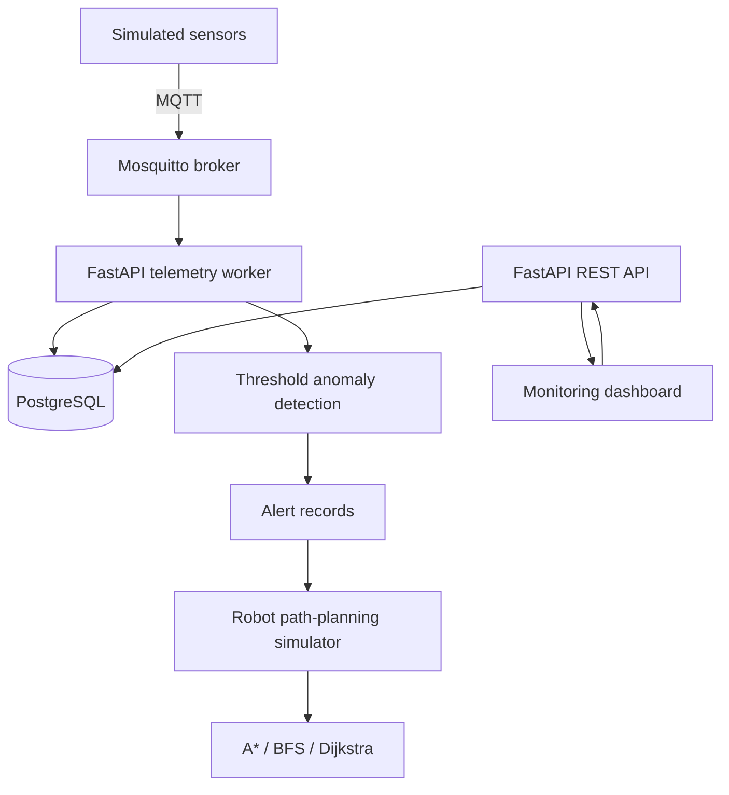

# Smart Laboratory Monitoring & Autonomous Inspection System

An in-progress prototype for monitoring a simulated laboratory, detecting abnormal sensor readings, and comparing grid-based robot path-planning algorithms.

> **Status:** Initial prototype scaffold. Simulated telemetry only; no physical robot or real laboratory equipment is controlled. Run and validate the complete stack locally before describing it as tested.

## Architecture



## Included
- Simulated temperature/vibration telemetry over MQTT.
- MQTT subscriber persists readings and threshold alerts.
- FastAPI endpoints for health, readings, alerts and path comparison.
- PostgreSQL persistence through SQLAlchemy.
- A*, BFS and Dijkstra for four-directional grid navigation.
- Auto-refreshing browser dashboard.
- Pytest unit tests and Docker Compose configuration.

## Stack
Python 3.12, FastAPI, Paho MQTT, PostgreSQL, SQLAlchemy, A*, BFS, Dijkstra, Docker Compose, Pytest.

## Run
Requires Docker Engine/Desktop with Compose:

```bash
docker compose up --build
```

Dashboard: http://localhost:8000/ · API docs: http://localhost:8000/docs · Health: http://localhost:8000/health · Path comparison: http://localhost:8000/api/path/compare

Stop with `docker compose down`. To delete the database volume too, use `docker compose down -v` (destructive).

## Endpoints
| Method | Endpoint | Purpose |
|---|---|---|
| GET | `/health` | Health check |
| GET | `/api/readings?limit=50` | Recent sensor readings |
| GET | `/api/alerts?limit=50` | Recent anomaly alerts |
| GET | `/api/path/compare` | Compare algorithms on a sample grid |

## Results
No performance results are claimed yet. Run repeated tests before reporting quantitative conclusions.

| Metric | Evidence to collect |
|---|---|
| Sensor pipeline | Messages visible in the readings endpoint |
| Anomaly detection | Abnormal readings create alert records |
| Path planning | Routes reach goal without crossing obstacles |
| Algorithm comparison | Path length, explored nodes, elapsed time on identical maps |
| Full-stack integration | Successful local Compose run and test suite |

## Status
**Scaffolded:** simulated MQTT telemetry, FastAPI endpoints, database models, threshold anomaly detection, path-planning algorithms, dashboard, Compose configuration and initial tests.

**Next:** run/debug the stack locally; connect alerts to explicit inspection missions and robot movement; add integration tests; collect repeatable benchmarks; capture a screenshot/GIF from the real running dashboard.

## Safety
All telemetry and robot behavior are simulated. This is an educational prototype, not a certified laboratory safety system. Do not connect it to or use it to control real equipment.
